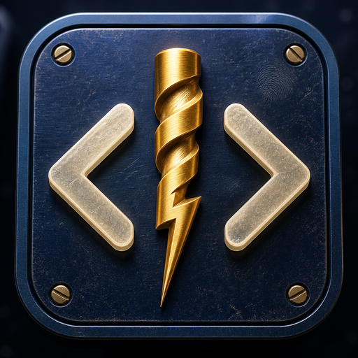

<p align="center">
  
</p>

# Dev Drill

Web development and CompTIA A+ quiz app. Pick a level and track, then take a multiple choice quiz. Questions come from a curated question bank stored in MongoDB (`data/questions/frontend.json` and `data/questions/aplus.json`), seeded on first use and upserted by key — no AI generation at runtime. Run `npm run seed:questions` to seed the bank manually.

## Stack

- **Next.js** (App Router): UI + API / server actions
- **TypeScript**
- **Tailwind CSS**
- **MongoDB** via **Mongoose**
- **Zod**: validation

## Getting started

```bash
npm install
npm run dev
```

Open [http://localhost:3000](http://localhost:3000).

Fill in `.env` with your MongoDB connection string when you add it.

## Scripts

| Command         | Description              |
| --------------- | ------------------------ |
| `npm run dev`   | Start development server |
| `npm run build` | Production build         |
| `npm start`     | Run production server    |
| `npm run lint`  | Lint                     |
| `npm run seed:questions` | Seed the question bank from `data/questions/` |

## v1 scope (summary)

Junior / Mid / Senior × Frontend / A+ × mixed subjects. Fixed lengths (5 to 25) or Unlimited. Skip and rotate, grade on demand, stored explanations, quiz history, and personal best banners. Auth and public leaderboards come later.
